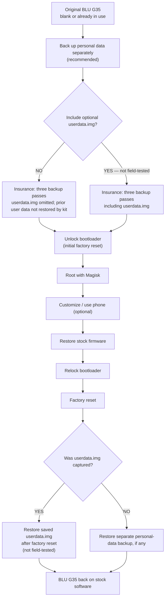

# BLU G35 (SC9863A) bootloader unlock — the guide

Audience: anyone. Every keystroke is written out. Nothing is assumed.
Total time: one focused hour for the unlock itself — plus a one-time
multi-hour insurance run (chapter 6), which is not optional.

> **Read this first — the five disclaimers.** Full text in `DISCLAIMER.md`;
> the short form: (1) firmware work can brick a phone; every software-reachable
> failure encountered on the tested hardware was recovered, but that is not a
> universal guarantee; (2) use the exact model and firmware; (3) the stock
> rollback was tested twice, then the consolidated workflow was run end to end
> in a third rooting run; (4) optional `userdata.img` capture/restore was not
> selected during hardware tests — do not rely on it as your only backup;
> (5) report your result so the next person has evidence.

## At a glance: the full lifecycle



The diagram is an overview, not a substitute for the step-by-step gates. The
optional `userdata.img` restore path has not been validated in the maintainer's
physical test runs; see the personal-data notes below and chapter 6.

---

## 0. Glossary — read this once

| word | meaning |
|---|---|
| **BootROM / BROM** | code burned into the chip at the factory. Firmware and OTAs cannot rewrite it. This kit uses its download-mode path as the entry point; that does not make the method universal beyond the exact model/build this kit verifies. |
| **download mode** | a phone state where the BootROM listens over USB. Reached by: power off (~10 s hold), hold **VOL_UP**, plug the cable. On the tested device, it remained reachable across every software failure state encountered; this is not a guarantee against arbitrary hardware failures. |
| **fastboot** | the phone's own boot-menu flashing tool. On THIS phone its write command is broken (proven twice). This kit does not use it for writes — ever. |
| **partition** | a named slice of the phone's storage (splloader, uboot_a, miscdata, …). Think "files that live below the filesystem". |
| **slot a / slot b** | two copies of boot-critical partitions; the phone boots from the active one (yours: `a`). We patch both so it does not matter. |
| **hash / sha256** | a fingerprint of a file. If one byte changes, the fingerprint changes. We hash before and after every write. |
| **read-back** | after writing to the phone, we read the same region back and hash it. If it does not match what we sent, we stop. |
| **spd_dump** | the one tool this kit needs (prepare.sh fetches and builds it from TomKing062/spreadtrum_flash at a pinned, field-certified source revision when `SPD_DUMP_HOME` is unset; export `SPD_DUMP_HOME` to use your own build). It talks to the BootROM in download mode. |
| **insurance** | the kit's name for three backup passes over the insured partition set, verification, and one certified master copy. `userdata.img` is optional; see chapter 6. It is your device-specific restore source and USB health test. |

---

## 1. What you need

- the phone: BLU G35 (Unisoc SC9863A), battery well above 40%, stock
- a USB **data** cable plugged directly into the computer (no hub) — and a
  spare if you have one; a bad cable is the single most common failure
- a computer running **Linux** (see chapter 3 if you only have Windows)
- budget about 120 GB for the full insurance run; actual needs depend on the
  selected partition set and whether `userdata.img` is included (chapter 6)
- the kit, acquired from the release repository — git clone (next chapter)
  or the release's ZIP
- internet access: once, for the one-time spd_dump fetch+build (chapter 2,
  step 2; skipped when you export a build you already trust as
  `SPD_DUMP_HOME`) — and, when you reach the root step, one more for the
  Magisk APK fetch in `./root_with_magisk.sh` (chapter 8) — skipped there
  too if you hand over the APK yourself (`MAGISK_APK=`). Rooting is part
  of the procedure; only the download is replaceable
- `git`, `gcc`, `make` and the libusb-1.0 headers (for that one build)

### If the phone already contains personal data — read before unlocking

The unlock procedure performs a factory reset. Before starting, copy anything
you need to keep off the phone and verify that the copied files can be opened.
Keep an independent copy on a computer or external storage; do not rely on the
kit's optional `userdata.img` path as your only backup.

A practical user-managed backup is usually faster than capturing a full
`userdata.img`:

- **Photos, videos and documents:** copy `DCIM/`, `Pictures/`, `Movies/`,
  `Documents/`, `Download/`, and any relevant app-specific folders to a
  computer or external drive over USB. [LocalSend](https://localsend.org/)
  is an optional open-source way to transfer selected files over a local
  network.
- **SMS/MMS, call logs and contacts:** [SMS Import / Export](https://f-droid.org/packages/com.github.tmo1.sms_ie/)
  is an open-source, no-root option for supported data types. Its contacts
  import/export is marked experimental upstream, so verify that the exported
  contacts can actually be restored.
- **Apps and their private data:** use each app's own export or backup
  facility where available. [Neo Backup](https://github.com/NeoApplications/Neo-Backup)
  can back up app data on a rooted device, but it requires root and therefore
  is not a pre-unlock solution for an ordinary stock/unrooted BLU G35.

No single app-based method preserves every app's private data. **Recommended
default for a phone with existing data:** make and verify an independent backup,
then select NO when the kit asks whether to capture `userdata.img`. This avoids
the extra capture/verification work while keeping your separate backup as the
data-restoration path. If you select YES, keep the independent backup anyway:
the kit intends to capture and restore the image, but that optional path was
not exercised in the maintainer's physical tests; see chapter 6. If you select
NO, `userdata.img` is omitted and the kit's rollback will not restore the
phone's previous user-data partition.

### The tested device identity — check this BEFORE the backup phase

| property | tested value |
|---|---|
| model (`ro.product.model`) | `G35` (BLU G35) |
| firmware build (`ro.build.display.id`) | `UP1A.231005.007` |
| kernel | `5.15.178-android13` (2025-04-15 build) |
| SoC target (`uboot_log` target line) | `sp9863a_1h10_go` |
| official/splloader.bin sha256 | `493b54241f201a03ba175752bea9345e987737340ec5f763645550280d3aa124` |
| official/uboot.bin sha256 | `68c1b59986204ffada680d304c560839b6a188000b63f90c73a205d7381fb2a3` |
| official/init_boot_a.bin sha256 | `d88fd220992deaf4df8c4543f5289621c3af00995818735cc89001d76dfb3e0d` |

You never hash your own phone manually — `scripts/step02` fingerprints
YOUR phone against the kit's shipped dumps (read-only, ~1 minute, before
any write-capable command exists) and hard-fails on a mismatch with NO
override, by design. But you can avoid wasting the multi-hour backup
phase entirely: check the build ID in Settings → About phone BEFORE
`./insure.sh`. A different build ID means this kit is not for your phone —
do not begin, and tell us, so a kit variant can
be built and field-verified. The dump hashes above are shipped inside the
kit and re-verified by `./verify.sh` against the MANIFEST on every fresh
copy — they are the reference side of step02's comparison.

---

## 2. Workspace setup — keystroke by keystroke

Open a terminal and type exactly this, in order:

```bash
# 1) make the workspace and get the kit into it — ONE command. The clone
#    lands in a folder named blug35_unlock_kit, which every later step in
#    this guide counts on verbatim:
mkdir -p ~/BLU35_WORKSPACE
cd ~/BLU35_WORKSPACE
git clone https://github.com/mpse-engineering/BLU_G35.git blug35_unlock_kit
#    ZIP edition instead? unzip it, then rename the folder:
#    mv BLU_G35-* blug35_unlock_kit
#    (a tarball handed over directly by the maintainer? extract it the same
#    way — the folder name is what matters: tar xzf <kit>.tar.gz)

# 2) COMPILE + DEPENDENCY — prove every patch artifact derives from the real
#    firmware, and fetch/build spd_dump (one-time; needs git, gcc, make,
#    libusb-1.0 headers — the script prints the exact apt line if missing)
cd blug35_unlock_kit
./prepare.sh

# 3) SETUP — verify the dependency is registered for the whole workspace
cd ..
./blug35_unlock_kit/setup.sh

# 4) VERIFY — integrity + full offline self-test (no phone needed)
#    (we are back inside the kit directory from here on)
cd blug35_unlock_kit
./verify.sh

# 5) INSURE — three complete backups + verification (chapter 6)
./insure.sh

# 6) RUN — the guided unlock procedure
./run.sh
```

Notes on the dependency, once:

- the gates look for **`SPD_DUMP_HOME`** — a directory containing the built
  `spd_dump` binary.
- **Unset** (the normal case): `prepare.sh` clones the source into the
  workspace, checks out the **pinned certified commit**, builds it, records
  the path in `../.spd_dump_home`, and exports it for the rest of the run.
  What happens is exactly this, and you watch it happen:

  ```bash
  git clone https://github.com/TomKing062/spreadtrum_flash.git
  cd spreadtrum_flash
  git checkout d24c21a0c93a545c0130668caa1826d59ceebe48  # pinned: certified tree
  make
  ```

  The pin is deliberate: upstream `main` has moved past the revision this
  kit was field-proven with (newer main even needs `libxml2-dev` to build).
  The pinned source produces the binary whose session banner self-reports
  `sha1:d24c21a0c93a545c0130668caa1826d59ceebe48` — the gates verify that
  line before accepting the build.

- **Set** (you already have a build you trust):

  ```bash
  export SPD_DUMP_HOME=/path/to/spreadtrum_flash
  ```

  Your build is used untouched. An explicit export always wins over the
  recorded path.
- after step 2, every gate finds the path automatically — running gates in
  separate terminals needs no exporting at all.

**What you will see** at each gate:

- `prepare`: ends with `prepare: ALL PROOFS PASS` and the resolved
  `SPD_DUMP_HOME`. Anything else in the PROOFS = the kit was altered or
  corrupted → stop, re-extract.
- `setup`: ends with `setup: DEPENDENCY READY` and prints the binary path.
- `verify`: ends with `verify: ALL CHECKS PASS` after
  `offline self-test: 13/13 scenarios pass`.
- `insure`: ends with `insure: DEVICE INSURED` (takes hours; chapter 6).
  Its device-session output is shown live and logged to
  `logs/insure_session.log`.
- `run`: prints the disclaimers once, then the step plan, and asks
  `type RUN to execute it, S to stop` before **each** step.

**What you will NOT see** hidden from you: every device session streams its
output to the terminal. An unconnected phone looks like a sitting
`Waiting for dl_diag connection` line; a failure is printed, never buried.

**Network**: exactly two touches, both conditional: the one-time spd_dump
fetch+build in step 2 (only when you did not export `SPD_DUMP_HOME` with
your own build), and the Magisk APK fetch in chapter 8's
`./root_with_magisk.sh` (only when you did not supply `MAGISK_APK=`).
Nothing else downloads; nothing phones home.

---

## 3. Windows users: the one-hour Linux (live USB)

The kit runs on **Linux only** — not because of ideology, but because of
physics: Windows intercepts the phone's USB device before any tool can talk
to it (drivers, adb servers, timing), and every workaround built on Windows
inherits the problem. We tried. It is not certifiable, so it is not
supported. You do not need to install Linux to get it:

1. Download **Ubuntu Desktop** (ubuntu.com) and write it to an 8 GB+ USB
   stick — Windows users: use balenaEtcher, select the .iso, flash.
2. Reboot the PC and boot from the stick (tap F12/F2/Esc during power-on —
   the exact key shows on your screen; look for "boot menu").
3. Choose **Try Ubuntu** (not Install). You get a full Linux desktop,
   running from RAM, with native USB access and nothing installed that can
   intercept the phone. Your Windows disk is untouched.
4. You need internet ONCE in this session: with the kit in place (clone or
   ZIP above), `./prepare.sh` fetches and builds spd_dump from
   github.com/TomKing062/spreadtrum_flash (pinned to the certified source
   revision). (Or bring your own built copy on
   the second stick and `export SPD_DUMP_HOME=/path/to/spreadtrum_flash` —
   then no internet is needed at all.)
5. Follow chapter 2 from a terminal inside the live session. Note: the live
   desktop's disk is RAM — keep the workspace on the second stick or an
   internal drive you mounted, or everything is lost on reboot (the
   insurance backups must NOT live in RAM).

**On WSL specifically**: tried; Windows interception plus USB-over-IP
latency break the download-mode sessions mid-chain, which looks exactly like
"the tool doesn't work". Not supported — use the live USB, it is genuinely
easier.

---

## 4. Access to the USB device (Linux)

Try the simple thing first — the steps will tell you if it fails:

**Option A — run the steps with sudo** (simplest, used in the field):

```bash
sudo -E ./run.sh        # -E keeps your environment (SPD_DUMP_HOME)
```

**Option B — udev rule** (no sudo afterwards). Create the rule, reload,
re-plug the phone:

```bash
sudo tee /etc/udev/rules.d/51-sprd-dl.rules <<'EOF'
SUBSYSTEM=="usb", ATTRS{idVendor}=="1782", ATTRS{idProduct}=="4d00", MODE="0666"
EOF
sudo udevadm control --reload-rules
```

If a step waits forever: the phone is not in download mode (power off 10 s,
hold VOL_UP, plug), or an adb server is running (`adb kill-server` — it
steals the device).

---

## 5. The procedure, end to end

```
prepare → setup → verify → insure → run (steps 00..08) → root (chapter 8)
```

| gate | touches phone? | what it does |
|---|---|---|
| prepare | no | rebuild-proofs every patch artifact from the shipped firmware |
| setup | no | verifies the spd_dump dependency (SPD_DUMP_HOME) |
| verify | no | manifest + 28 artifact proofs + 13-scenario offline self-test |
| **insure** | **READ-ONLY** | **3 backup passes; key partitions verified across all three; certified master (chapter 6)** |
| run step00–01 | no | environment preflight, package integrity |
| step02 | **NO — read-only** | fingerprints YOUR firmware against the kit; mismatch = hard fail, no override |
| step03 | no | RAM-boot proof of the patched SPL (nothing written); if it does not boot, up to TWO guided retries are offered |
| step04 | YES (splloader, uboot_a/b) | stage: erase splloader, patched LK into both slots (read-back-verified) |
| step05 | YES (uboot_a/b, miscdata) | **THE UNLOCK** — stage the cboot writer, then RAM-boot it; the phone goes **black** during the write; that black screen IS success-in-progress |
| step06 | **NO — read-only** | shows the lock block. Populated = **unlocked** |
| step07 | YES (splloader, uboot_a/b) | restores the official boot chain, hash-verified; the unlock flag survives |
| step08 | YES (misc) | stages the factory wipe — but first asks whether the on-screen reset already happened (if it did: no second wipe) |

**Kill-switch rule**: every writing step prints the exact partitions it
will touch BEFORE the typed YES. Read it. Anything unexpected → answer NO.

**Stop-and-paste rule**: any red `FAIL:` means stop. Do not improvise, do
not "just run the next one". The transcript is in `logs/<step>_<timestamp>.log`.

### What the phone shows along the way (expected, not bugs)

- USB sessions: the phone screen stays black; it sits in download mode.
- step03 and step05's fire: the phone **reboots**. step03 → normal boot.
  step05 fire → **black screen, stays dark** — the writer is running.
- step03 honesty: some devices boot **silently** (no logo, no vibration).
  The host-side proof of execution is the session's teardown signature in
  your terminal (`device removed` / `CHECK_BAUD FAIL`); the verdict is the
  screen — Android appearing within ~60 s. If it does NOT boot: one retry
  is routine ("may need twice", same as step05) and the phone is untouched
  either way. The step walks you through the power-cycle and download-mode
  re-entry, and offers up to two retries before it stops.
- after step07 + step08: first boot shows the **unlocked-bootloader
  warning**, then recovery asks for a **factory data reset** — accept it.
  Your data was encrypted under the locked state and is unreadable now;
  the wipe is expected, and the unlock flag survives it. step08 itself
  first asks whether that on-screen reset already happened after step07's
  boot — if you already accepted it, the wipe is done and step08 stages
  nothing (a staged wipe would only run a SECOND time).

---

## 6. Insurance — why you do not skip this

`./insure.sh` reads the insured partition set **three times** — into
`backup1/`, `backup2/`, `backup3/` in the workspace — with a normal boot
between sessions. Each backup is **one single download-mode session** (all
selected partitions in a row; one-shot sessions have no command limit), so you
enter download mode three times total, not once per handful of partitions.
During insurance, the kit asks whether to include `userdata.img`. **Recommended
default:** back up important personal data separately and select NO. Choose YES
only if you deliberately want to try the optional, unfield-tested image path
and you have another verified backup.

- **NO:** `userdata.img` is omitted from the backup set and certified master.
  The kit's rollback cannot restore the phone's prior user-data partition;
  restore a separate backup manually, if you made one.
- **YES:** the kit captures `userdata.img` and runs its image-integrity checks
  as part of the insurance process. Because user data can change between
  boot-separated sessions, it is not required to be byte-identical across all
  three sessions like the key partitions below. The saved image is intended
  to be written back only **after** stock firmware is restored, the bootloader
  is relocked, and the factory reset has completed.

**Testing boundary:** The maintainer did not select YES for `userdata.img`
when running the physical test cycles. The option is implemented using the
same image capture/write path as other partitions, so the maintainer expects it
to work, but the user-data-specific capture-and-restore path has not been
field-tested end to end. Do not treat it as your only backup; preserve and
verify an independent copy of anything important.

Then it verifies:

- **KEY partitions** (boot chain, modem/DSP firmware, factory NV, TrustOS):
  must be byte-identical across all three. Any difference = your USB path
  is unreliable → HALT, no override. Fix the hardware and re-run the failed
  session — the kit resumes, it does not restart.
- **VOLATILE partitions** (logs, counters, cache, runtime NV, and
  `userdata.img` only when selected): legitimately change across boot-separated
  sessions. They are captured where included, but excluded from the requirement
  that KEY partitions be byte-identical across all three sessions. If the
  userdata option is declined, `userdata.img` is omitted entirely rather than
  retained for rollback.
- **anything else**: you get a named warning and decide (typed YES).

On pass it assembles `$BLU35_WORKSPACE/firmware/` — the **certified master**:
checksummed copies of the partitions retained by the insurance configuration.
This is the restore source for each captured/restorable partition, including
per-device NV data no kit could ever ship for you. `userdata.img` is present
only if you selected it during insurance.

**The cost of safety, stated plainly:** the full insurance run is a
multi-hour operation. Budget about 120 GB for the full partition set; actual
storage and transfer time can be lower if optional `userdata.img` capture is
omitted. That is not an accident or waste; it is the cost of establishing and
checking a phone-specific recovery source. It reduces risk but cannot
guarantee recovery from every possible hardware fault or unanticipated
failure. Safety is above anything. If you cannot afford the time or disk,
do not proceed.

It is also the USB health test: three full reads move more data than the
entire unlock ever will. A bad cable dies here, read-only, where it costs
nothing. (The author's own cable failed this test. That is the point.)

**Sessions are resumable.** If a session dies mid-way (cable, port,
sleep), just re-run the same command: it reads only the partitions that
are missing or short of their exact GPT size — a truncated file never
counts as captured. A completed session re-run needs no phone at all.
`./insure.sh --fresh sessionN` throws away that backup's captures and
starts it over if you want zero doubt.

---

## 7. If anything fails — triage table

| what you saw | what it means | what to do |
|---|---|---|
| `find port failed` / waits forever | not in download mode, or adb grabbed the device, or no permission | re-enter download mode; `adb kill-server`; try `sudo -E` |
| `step02 ... does NOT match` | firmware revision differs from this kit | **stop.** No override exists. Do not improvise. |
| insurance HALT on KEY partitions | cable/port unreliable | fix the hardware, `./insure.sh session2` (etc.) — it resumes |
| a write step FAILs on a hash | the expected write/read-back state was not confirmed | stop; do not boot or continue; preserve the log and follow the documented recovery path / ask for help |
| step03: "no boot" on the first attempt | a first no-boot is routine — the maintainer's "may need twice" applies to the RAM-boot too | answer y at the retry prompt (power-cycle, re-enter download mode); the step only hard-stops after 3 attempts, and its stop message names the exact log to paste |
| Magisk shows "N/A" after root | wrong image or wrong slot | re-do chapter 8 with the correct Magisk-patched image |
| a module bootloops the phone | bad module | hold **VOL-DOWN** through boot = Safe Mode (modules disabled), remove the module |
| anything else | — | stop, paste `logs/<step>_*.log` |

**Recovery coverage for the tested procedure:** captured partitions that the
procedure modifies are restored from the certified master (`firmware/`), with
hash verification through download mode. On the tested device (chapter 1
identity card), every software-reachable failure state encountered during
development was recovered through download mode. This is demonstrated
recovery coverage for the tested hardware and workflow, not a guarantee
against hardware faults, uncaptured data, or failure modes not encountered.

---

## 8. Root with Magisk (gated, like everything else)

The unlock alone does not root the phone. The patched `init_boot` does —
and you build that image yourself, on the phone, so the kit never ships
boot images at all.

### The one-command way

With the phone booted normally, Developer options + USB debugging on, and
the adb authorization prompt accepted:

    ./root_with_magisk.sh

It does this whole chapter in order, printing every gate:

1. fetches the **latest Magisk APK** from the official GitHub releases and
   prints its sha256 (the only network touch; `MAGISK_APK=/path/to.apk
   ./root_with_magisk.sh` skips the fetch — pinned or fully offline)
2. installs it with adb
3. pushes the **stock** `init_boot` from your certified master to the
   phone — the Magisk app patches THAT, so double-patching cannot happen
4. walks you through the four taps (Magisk → Install → Select and Patch a
   File → `init_boot_stock.img` → LET'S GO) and waits for the result
5. pulls `magisk_patched-XXXXX.img` back and writes it with the gated
   writer — download mode, kill-switch prompt, hash-verified read-back

If the fetch cannot reach GitHub, the script prints the browser URL and
exits cleanly: download the APK by hand, then re-run with `MAGISK_APK=`.

### After an OTA removes root: one command

    ./root_with_magisk.sh --ota

An OTA boots a NEW stock init_boot — patching the kit's insurance-snapshot
copy would put old software on a new system. `--ota` does the whole
recovery in order, with every gate printed:

1. phone in download mode: a READ-ONLY session reads BOTH init_boot slots
   straight off the phone (logged to `logs/`)
2. guard: if a read image still carries the Magisk signature, root was not
   actually removed (the OTA did not replace init_boot) — it refuses and
   stores nothing
3. an unchanged slot is kept as-is; a changed, un-signed slot is stored
   beside the certified master (`firmware/init_boot_X.ota-stock.bin`) with
   a written record (`OTA-STOCK.txt`) and the master's CHECKSUMS refreshed.
   The canonical master files stay the pre-OTA insurance snapshot —
   `rollback_to_stock.sh` restores the stock partitions retained in that
   master; optional `userdata.img` behavior is described in chapter 6 and
   has not been field-tested.
4. then it installs Magisk, patches THAT current-stock image in the Magisk
   app, and writes it through the gated writer — exactly like the normal
   mode, so the patched image matches the OTA'd system

Note: after an OTA, `step02` would refuse the phone by design (one kit =
one firmware revision, no override) — `--ota` is the sanctioned post-OTA
path, and a later `./insure.sh` re-run re-baselines the whole master to
the post-OTA phone.

### The manual way (same steps, by hand)

1. get the Magisk APK (github.com/topjohnwu/Magisk) and
   `adb install Magisk-vXX.X.apk` — phone booted, USB debugging on,
   authorization accepted
2. copy the stock `init_boot` from your certified master
   (`../firmware/init_boot_a.bin`) onto the phone
3. Open Magisk → *Install* → *Select and Patch a File* → pick it →
   it writes `magisk_patched-XXXXX.img` — copy that back to the computer
4. Write it with the gated writer — NOT fastboot (its write path is broken
   on this phone, proven twice):

```bash
IMG=magisk_patched-XXXXX.img ./write_init_boot.sh
```

   The script checks the image size, asks you to confirm, shows the
   kill-switch prompt, writes through the download agent, and reads the
   partition back — the hashes must match or it tells you not to boot.

5. Boot, open Magisk → expect **Installed**. Hard proof: `adb shell su -c id`.

**After a future OTA removes root** (see chapter 9): same chapter, same
tool — read the new stock image out, patch it in the Magisk app, write it
back with `write_init_boot.sh`. Root restored, data intact. (With the
helper: re-run `./root_with_magisk.sh` once the master holds the new stock
image.)

---

## 9. Living with an unlocked, rooted phone

- The boot warning at every power-on is the unlock flag doing its job.
- **OTAs.** Do not accept an OTA while `init_boot` is Magisk-patched
  without thinking. If one lands anyway and root disappears:
  `./root_with_magisk.sh --ota` (chapter 8) reads the NEW stock init_boot
  off the phone, guards it, and re-roots from the current stock — one
  command. The BootROM entry point is not replaced by an OTA, but the stock
  firmware does change; use the sanctioned `--ota` path described here.
- **Safe Mode escape hatch:** VOL-DOWN held through boot disables all
  modules for that boot.
- **Magisk updates** are in-app (*Install → Direct Install → reboot*);
  no computer needed.
- Module users: **Zygisk** ON if you run LSPosed; keep **Enforce DenyList
  OFF** while LSPosed is active (it unmounts Magisk's modifications and
  breaks LSPosed hooks inside listed apps — hide from apps via LSPosed's
  own mechanism instead).

### Privacy: default-deny

The author's policy, offered as the recommended posture: **deny everything
by default; an app gets nothing unless you explicitly granted it.** Root +
Zygisk/LSPosed gives you the hooks to enforce it system-wide, including
controlling which apps can see which packages. The one honest limit: fully
de-Googling a device is achievable but fiddly — budget real time. On the
tested device, software-reachable failures encountered during development
were recovered through download mode; that history is not a guarantee for
every possible failure.

---

## 10. Unroot / return to box state

Changed your mind, or returning the device? `./rollback_to_stock.sh`
(requires the insurance stamp — the certified master is what makes this
safe and per-device):

- **Full box state**: restores the captured stock partitions
  (hash-verified per partition — this unroots by overwriting the Magisk
  `init_boot`), then **relocks** the bootloader (a surgical 64-byte flag
  write, with a snapshot kept as instant undo), then performs the required
  factory reset. **Only after that reset**, if `userdata.img` was selected
  during insurance, the saved image is written back. If you declined the
  option, the kit cannot restore the phone's prior user-data partition; use
  your separate backup, if any. The optional `userdata.img` restore path has
  not been field-tested by the maintainer (chapter 6). Final read-only
  confirmation checks the stock chain and locked state; the reset is completed
  before any optional `userdata.img` restore.
- **Unroot only**: stock `init_boot` back, root gone, bootloader stays
  unlocked, data untouched.

The tested method uses the BootROM download-mode path regardless of the
bootloader lock flag, allowing the tested unlock ↔ relock cycle to be
repeated on this device. Do not generalize that result to untested hardware
or firmware. No fuse was triggered during the tested cycles. On this BLU G35,
the box-state rollback ran twice, followed by a successful rooting run after
the fixes were consolidated (see `DISCLAIMER.md`, item 3).

A note on the NV/calibration partitions: the rollback push
deliberately never WRITES and never VERIFIES `l_fixnv1/2_a/b` (radio
calibration), `l_runtimenv1/2` (runtime NV), `calinv`, `persist`,
`metadata`, `uboot_log`, `sysdumpdb` or `blackbox`. Calibration is
per-device and untouched by rooting; device state and logs legitimately
differ from any earlier capture — comparing them only produces false
alarms (proven in the field: the first rollback run halted on exactly
such a comparison). The tool itself also refuses or mangles writes to
these (it would ERASE the runtime NV instead of writing it, and it
cannot read the fixnv main copies back — it silently returns the
mirror instead).

---

## 11. Be nice, and report back

When it works: `./make_report.sh` assembles your proof transcript
(model, build, kernel, root, Magisk), you attach one photo of the boot
screen showing the unlocked warning, and post it with the kit hash and
your firmware revision (the filled `SUCCESS_REPORT.md` template tells you
exactly what goes where — and what NOT to post: never your
`get_identifier_token` output, it is serial-derived).

That report is the same thing you searched for before starting. For the
next person at 1 AM with a TracFone and no unlock path, it is the reason
they try at all. Answer newcomers when you can. You were one once.

---

## 12. What this kit will not do

- no SIM/carrier changes, no modem work, no IMEI anything
- no firmware revisions other than the one step02 fingerprints — hard fail, no override
- no writes over fastboot, ever
- nothing downloads except the one-time spd_dump fetch (chapter 2) — and
  only when you do not supply `SPD_DUMP_HOME` yourself — plus the Magisk
  APK fetch in `./root_with_magisk.sh` (skipped with `MAGISK_APK=`);
  nothing phones home
- no Windows support (chapter 3 explains why, and what to do instead)

## 13. Provenance

- Method: CVE-2022-38694 (SPRD BootROM download-mode session, publicly documented)
- Patch artifacts: derived and byte-verified against the phone's own dumps
  by `./prepare.sh` on every fresh copy — the "compile" step IS the proof
- SPL patch: byte-identical to the canonical maintainer tool's output on
  this dump (20 NOPs, 5 sites, signature block kept)
- Unlock writer: the canonical `fdl2-cboot` — the download agent plus
  exactly the unlock-write words (re-proved on every prepare/verify run)
- Full engineering history: see the DevKit edition
